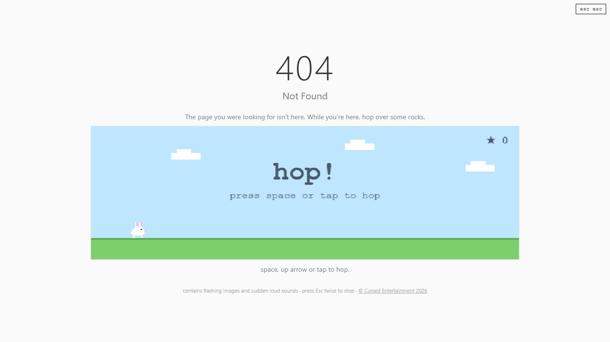

# guest_000

A browser horror game. It starts somewhere innocent.

**Play:** https://cursedprograms.github.io/guest_000/

> **Play it first. Don't read the code before you have.** The source spoils every surprise, and the game will ask you
> to look at certain things when it's time. Stuck? There's a [walkthrough](WALKTHROUGH.md) (spoilers).

It is **fiction**: nothing is installed and nothing is sent anywhere. The only thing kept is your name and your
progress, in this browser's localStorage. Press Esc twice, or the `esc esc` button in the corner, to stop at any time.

> Flashing images and sudden loud sounds. Headphones make it worse.

## Run it locally
Open `index.html`, or run `serve.bat` / `serve.sh` / `serve.ps1` and go to http://localhost:8666 (needed for
notifications).

  

---

© Cursed Entertainment 2026

 

